# Projekt 05: Netzwerkverkabelung Laden und Wohnung
 
Komplette Neuverkabelung des Netzwerks zwischen Laden und Wohnung: Kabel verlegt, RJ45-Module aufgelegt, Dosen montiert. Alle Arbeitsschritte habe ich selbst durchgeführt und mit Fotos dokumentiert.
 
**Status:** ✅ Abgeschlossen
**Zeitraum:** Oktober 2026
**Themen:** Strukturierte Verkabelung, Cat.7a-Kabel, geschirmte RJ45-Module, Kabelverlegung im Leerrohr, Funktionstest
 
---
 
## 1. Ziel
 
Eine stabile, kabelgebundene Netzwerkverbindung zwischen Laden und Wohnung. Die Glasfaser-Anbindung war bereits vorhanden und wurde nicht verändert. Meine Aufgabe war die komplette RJ45-Verkabelung dahinter.
 
## 2. Ausgangslage
 
- Glasfaser-Anschluss vorhanden
- Netzwerkgeräte (Netgear, TP-Link) am Arbeitsplatz im Laden
- Alte Telefon- und Faxdosen an der Wand im Laden
- Vorhandene Wellrohre zwischen Laden, Keller und Wohnung
- Kabelweg: Laden → Keller → Wohnung
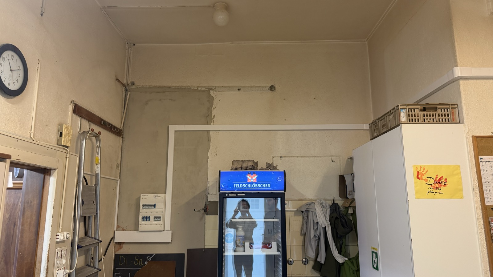
*Laden: Wand mit Unterverteilung, hier beginnt der Kabelweg.*
 
## 3. Material und Werkzeug
 
| Komponente | Details |
|---|---|
| Netzwerkkabel | Cat.7a, orange, ca. 35 m |
| RJ45-Module | R&M RJ45/s-C6 (Reichle & De-Massari), Nr. 302372, geschirmt |
| Dose im Laden | Aufputz-Doppeldose |
| Verlegehilfe | Zugseil (gelb-schwarz) |
| Befestigung | Kabelbinder als Zugentlastung, Schrauben |
| Werkzeug | Isolierte Schraubendreher, |
 
## 4. Vorgehen
 
### 4.1 Kabel verlegen
 
Das Kabel habe ich mit einem Zugseil durch die vorhandenen Wellrohre gezogen.
 
**Laden: Einführung in den Kabelweg neben der Unterverteilung**
 
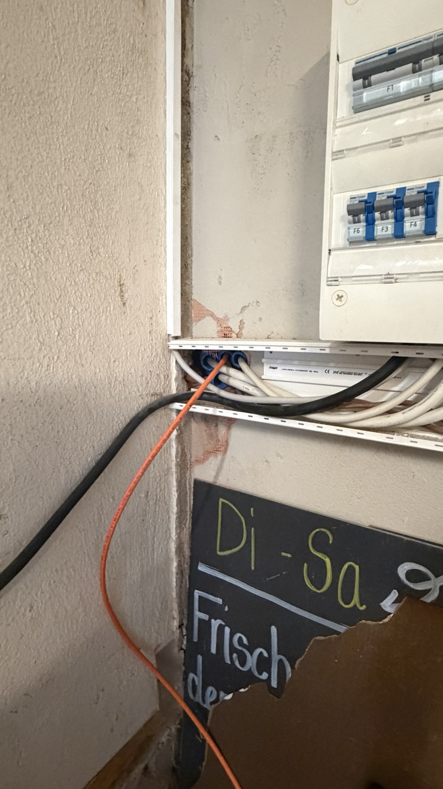 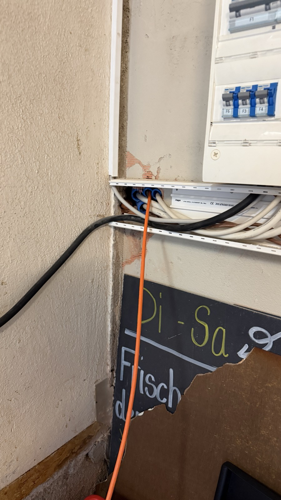
 
**Keller: Wellrohre mit eingezogenem Kabel**
 
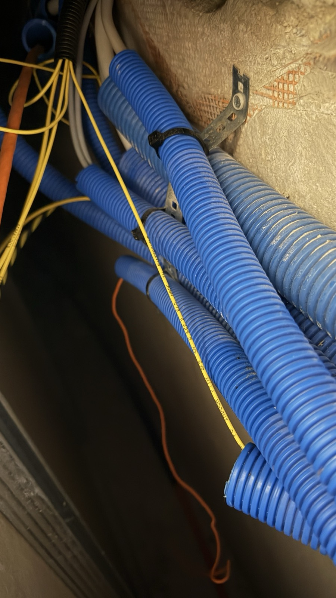
**Wohnung: Zugseil und Austritt des Kabels**
 
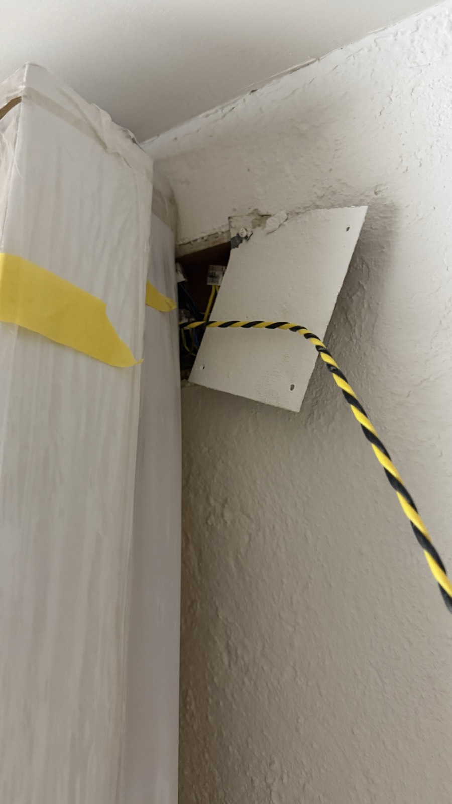 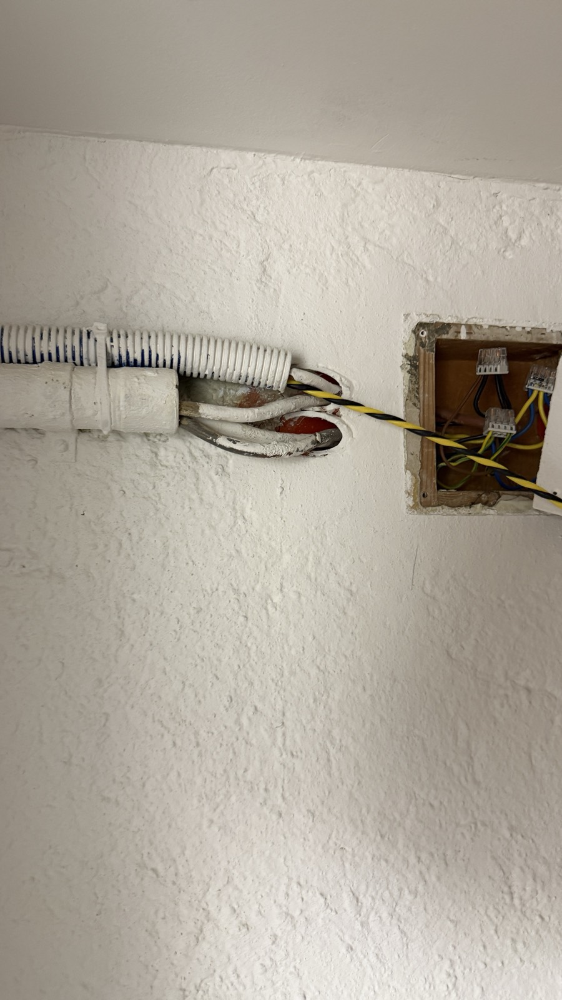 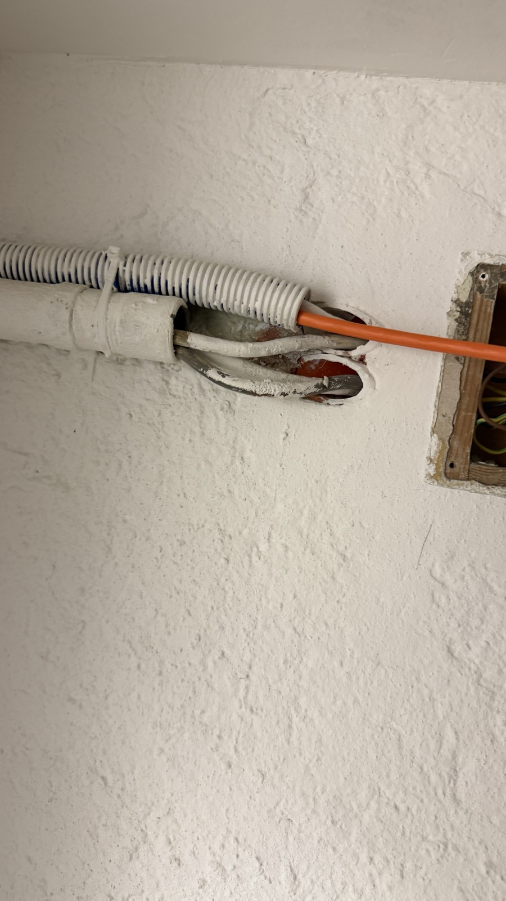
 
**Wohnung: Medienverteiler, Kabel läuft über das Wellrohr in den Verteiler**
 
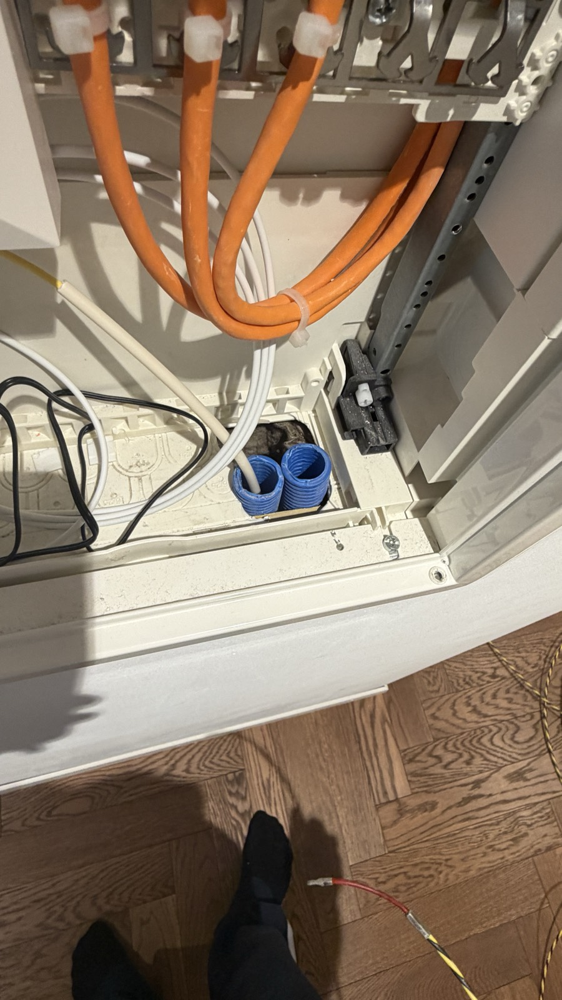 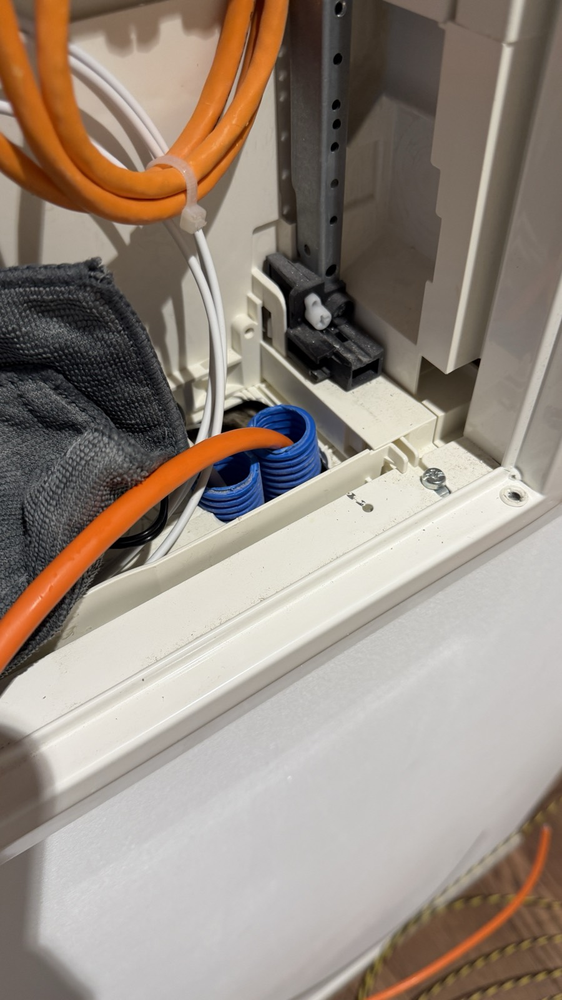
 
### 4.2 RJ45-Modul auflegen
 
Verwendet habe ich geschirmte R&M-Module (Typ RJ45/s-C6). Das Kabel wird mit einem Kabelbinder am Modul zugentlastet, der Schirm wird am Metallgehäuse kontaktiert.
 
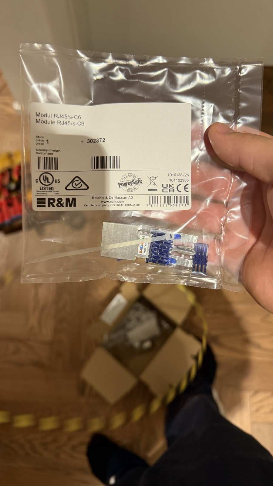 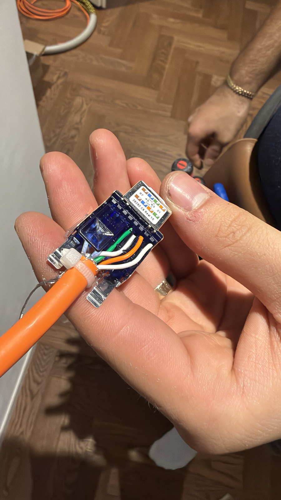 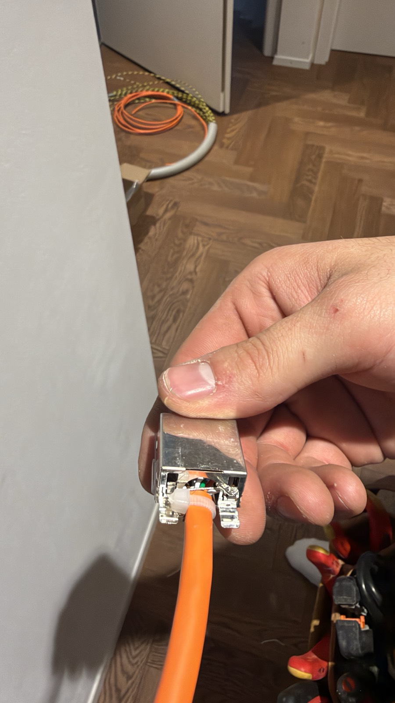
 
*Von links: Modul in der Verpackung, aufgelegte Adern, fertiges Modul mit Zugentlastung.*
 
### 4.3 Modul im Medienverteiler (Wohnung)
 
Das fertige Modul sitzt im Patchfeld des Medienverteilers. Die Kabel sind mit Kabelbindern fixiert.
 
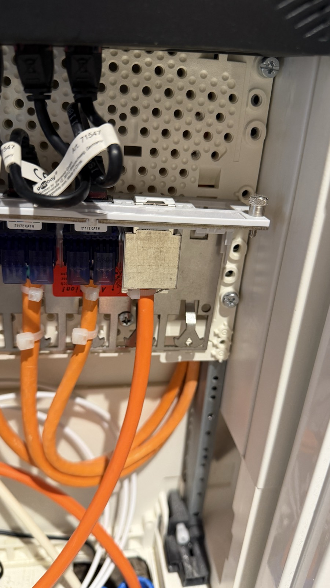
### 4.4 Dose im Laden montieren
 
Im Laden wird das Kabel am Türrahmen entlang zur Wanddose geführt. Dort habe ich eine Aufputz-Doppeldose neben den alten Telefon- und Faxdosen montiert.
 
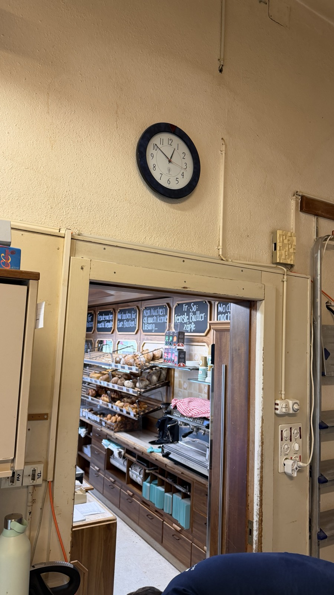 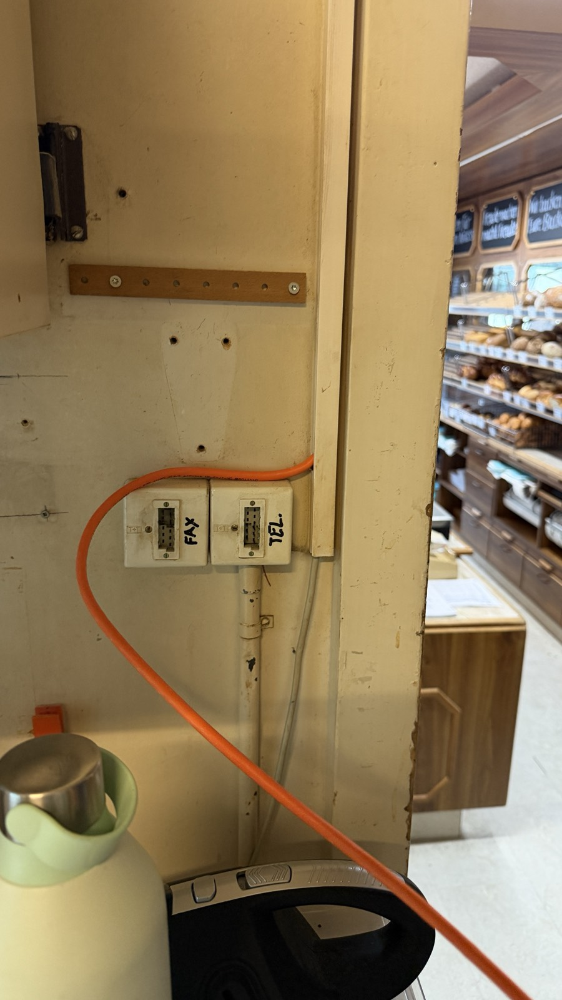 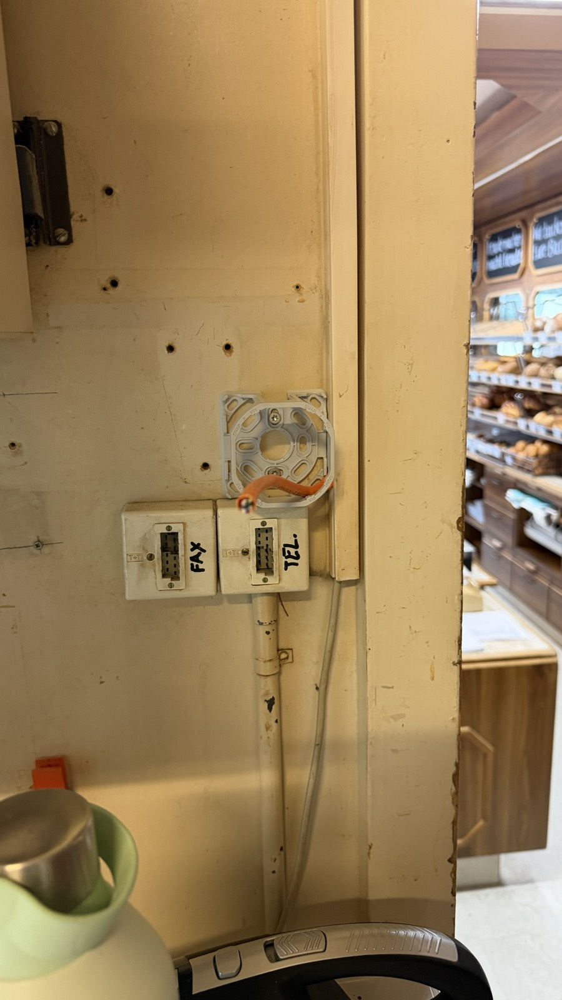
 
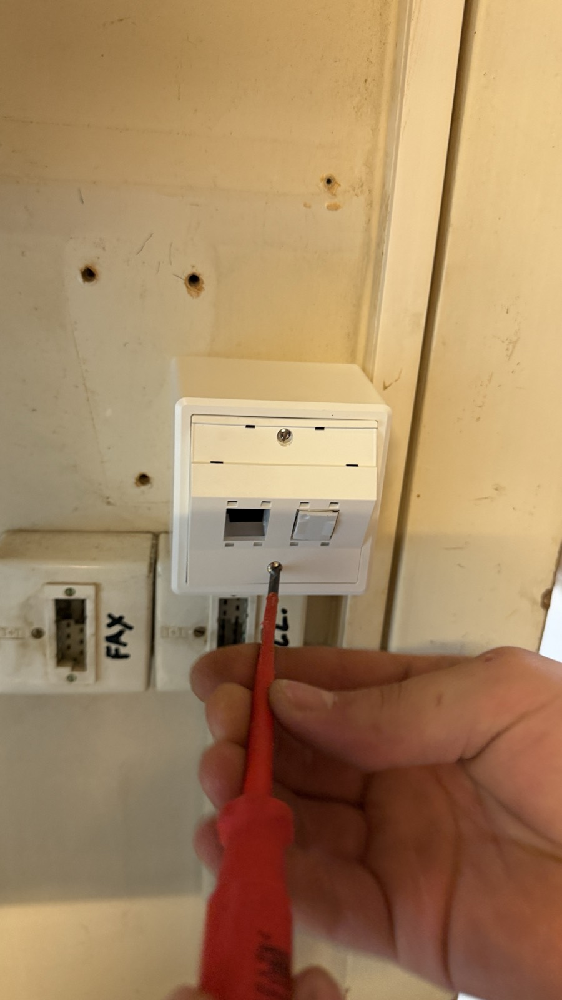
*Zuerst Kabelführung, dann Dosenrahmen mit Kabelende, zuletzt die verschraubte Doppeldose.*
 
## 5. Test und Verifikation
 
Ich hatte kein Kabelmessgerät. Eine Zertifizierungsmessung (Dämpfung, Nebensprechen, Wiremap) wurde deshalb **nicht** durchgeführt. Geprüft habe ich:
 
- Sichtprüfung: Sitz der Adern, Zugentlastung, saubere Montage
- Link-Test: Link-LED an Endgerät und Gegenstelle
- Funktionstest: Ping zwischen Laden und Wohnung,
## 6. Einordnung
 
Die Leistungsklasse einer Strecke bestimmt das schwächste Bauteil. Das Kabel ist Cat.7a, die verbauten Module sind Cat.6 (R&M RJ45/s-C6). Die Strecke ist damit als Cat.6-Verbindung einzustufen, nicht als Cat.7a. Für 1 Gbit/s reicht das aus. Das Cat.7a-Kabel bietet Reserve, falls später Module nachgerüstet werden.
 

## 7. Ergebnis
 
Laden und Wohnung sind über eine geschirmte Kupferverbindung (Cat.7a-Kabel, Cat.6-Module) vernetzt. Der Funktionstest war erfolgreich.
 
## 8. Gelerntes
 
- Zugseil und vorhandene Wellrohre sparen viel Aufwand, wenn der Weg vorher geklärt ist
- Geschirmte Module brauchen saubere Schirmauflage und Zugentlastung
- Die Streckenklasse bestimmt das schwächste Glied, nicht das beste Kabel
